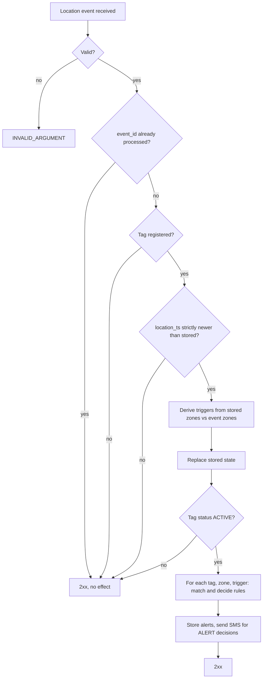

# Alert evaluation

This document specifies how a service implementing the Zonyx Alerts API turns
location events into alerts. It is the reference for implementers and for anyone
configuring rules. The contract is [`api/proto/v1/index.proto`](../api/proto/v1/index.proto);
where this document and the proto comments differ, fix the difference rather than
choosing one.

Contents:

- [Alert evaluation](#alert-evaluation)
  - [1. Concepts](#1-concepts)
  - [2. Processing a location event](#2-processing-a-location-event)
  - [3. Triggers](#3-triggers)
  - [4. Rule matching](#4-rule-matching)
    - [Time window](#time-window)
  - [5. Deciding between rules](#5-deciding-between-rules)
  - [6. Cooldown](#6-cooldown)
  - [7. Alert records](#7-alert-records)
  - [8. Rule management](#8-rule-management)
  - [9. Tags](#9-tags)
  - [10. Ingest responses and delivery](#10-ingest-responses-and-delivery)
  - [11. Worked examples](#11-worked-examples)
    - [Pool: alert on entry, with a cooldown and a night suppression](#pool-alert-on-entry-with-a-cooldown-and-a-night-suppression)
    - [A tag lost inside the danger zone](#a-tag-lost-inside-the-danger-zone)
    - [Overlapping rules with equal priority](#overlapping-rules-with-equal-priority)
    - [A tag in two zones at once](#a-tag-in-two-zones-at-once)
  - [12. Requirements for the implementing service](#12-requirements-for-the-implementing-service)
  - [13. Limitations and open points](#13-limitations-and-open-points)

## 1. Concepts

| Term         | Meaning                                                                                                       |
| ------------ | ------------------------------------------------------------------------------------------------------------- |
| Tag          | A registered device. Identified by `Tag.id`, which equals the event `tag_id`. Has phone numbers and a status. |
| Zone         | An area defined in the location provider. Identified by an id that is unique across the provider.             |
| Event time   | `LocationEvent.location_ts` (Unix ms). Orders the events of a tag and is the time rule windows use.           |
| Stored state | Per registered tag: the set of zones of the last applied event, and that event's `location_ts`.               |
| Trigger      | A situation derived from a change of the stored state: `ZONE_ENTRY` or `SIGNAL_LOST`.                         |
| Rule         | Decides what happens for a trigger: `ALERT` (send SMS) or `SUPPRESS` (do not).                                |
| Alert        | A stored record of a decision, one per phone number.                                                          |

Two properties of the input shape everything below:

- The event schema is provider-agnostic; events are translated into it by the
  publisher. `location_zone_ids` is the full set of zones the tag is in **now**.
- The provider reports a tag it lost and a tag that is simply outside every zone
  in the same way: an empty `location_zone_ids`. The schema does not distinguish them.

## 2. Processing a location event

Step by step:

1. **Validation.** The event must satisfy the proto validations (see `LocationEvent`),
   including `event_id` (1-128 chars), `location_ts > 0`, `location` empty or exactly
   `[x, y, z]`, unique zone ids, and as many zone names as zone ids.
2. **Deduplication.** An event whose `event_id` was already processed is acknowledged
   and has no effect. Delivery is at-least-once, so this is expected.
3. **Registration.** Events of a tag that is not registered are acknowledged and
   ignored. No state is created for them.
4. **Ordering.** If `location_ts` is not strictly newer than the stored one, the
   event is acknowledged and ignored; it never changes the stored state. Late events
   are therefore dropped, not merged.
5. **Triggers.** Derived from the stored zones and the event zones (section 3).
6. **State.** The stored zones and `location_ts` are replaced by those of the event.
   This happens for every registered tag, whatever its status.
7. **Status.** A tag with status `INACTIVE` stops here: no alert and no alert record.
8. **Resolution.** Each (tag, zone, trigger) is resolved independently with the
   rules as they are at this moment (sections 4 to 6).
9. **Output.** Alert records are stored and SMS are sent (section 7).

`TagInfoEvent` never raises alerts. It only refreshes the battery fields of the tag
(`Tag.battery_voltage`, `battery_alarm`, `battery_updated_at`).

## 3. Triggers

Let `S` be the stored zones (empty if the tag has no stored state) and `E` the zones
of the new event.

| Trigger       | Raised when                       | For which zones                 |
| ------------- | --------------------------------- | ------------------------------- |
| `ZONE_ENTRY`  | `E` has zones that `S` does not   | Each zone in `E` and not in `S` |
| `SIGNAL_LOST` | `S` is non-empty and `E` is empty | Each zone in `S`                |

A tag with no stored state (its first event) behaves as if `S` were empty, so every
zone in `E` is an entry. There is no expiry of the stored state: a tag that
disappears and later reappears in the same zone it was last seen in raises
`ZONE_ENTRY` only if a `SIGNAL_LOST` (or an event with other zones) replaced the
state in between. A tag that vanishes without any further event raises nothing.

| Stored `S` | Event `E`        | Triggers                                  |
| ---------- | ---------------- | ----------------------------------------- |
| (none)     | `{A}`            | `ZONE_ENTRY(A)`                           |
| (none)     | `{}`             | none                                      |
| `{}`       | `{A}`            | `ZONE_ENTRY(A)`                           |
| `{A}`      | `{A}`            | none                                      |
| `{A}`      | `{A, B}`         | `ZONE_ENTRY(B)`                           |
| `{A, B}`   | `{B}`            | none (leaving A while in B is not a loss) |
| `{A}`      | `{B}`            | `ZONE_ENTRY(B)` (A is not reported lost)  |
| `{A, B}`   | `{}`             | `SIGNAL_LOST(A)`, `SIGNAL_LOST(B)`        |
| `{A}`      | `{}`, then `{A}` | `SIGNAL_LOST(A)`, then `ZONE_ENTRY(A)`    |

Consequences worth knowing:

- Only an empty zone list is a loss. Leaving a zone for another one raises no
  `SIGNAL_LOST`.
- Because the provider reports a lost tag and an exit from every zone the same way,
  walking out of all zones also raises `SIGNAL_LOST`. Scope that with the rule
  selectors, time windows and `SUPPRESS` rules.
- Two events with identical zones and different `location_ts` raise nothing.

## 4. Rule matching

For a trigger on (tag, zone) at event time `t`, a rule matches when **all** hold:

1. `enabled` is true.
2. `rule.trigger` equals the trigger.
3. `zone_selector` is empty, or contains the zone id.
4. `tag_selector` is empty, or the tag id is in `tag_ids`, or the tag group name
   (`LocationEvent.tag_group_name`) is in `tag_group_names`. A tag matches by id
   **or** group.
5. `time_window` is unset or empty, or matches `t`.

"Empty" means no restriction in all three dimensions: an empty `ZoneSelector`, an
empty `TagSelector` and an empty `TimeWindow` match everything.

### Time window

`t` is `location_ts` of the triggering event, converted to the wall-clock date and
time of `timezone`. Only that wall-clock time is compared, so daylight saving
changes need no special handling. Let `d` be the local weekday and `h` the local
time of day.

| Window                                      | Matches when                                                                     |
| ------------------------------------------- | -------------------------------------------------------------------------------- |
| empty                                       | always                                                                           |
| `days` set, no times                        | `d` is in `days` (whole day, 00:00 to 24:00)                                     |
| no `days`, times set                        | `start <= h < end` on any day (or the overnight rule below)                      |
| `days` and times, `start < end`             | `d` in `days` and `start <= h < end`                                             |
| `days` and times, `start > end` (overnight) | (`d` in `days` and `h >= start`) or (the day before `d` in `days` and `h < end`) |

- `start_time` is inclusive and `end_time` is exclusive, both `HH:MM`.
- `start_time` and `end_time` are both set or both empty, and must differ.
- `days` are the days the window **starts** on: `days=[MONDAY]`, `22:00`-`06:00`
  covers Monday 22:00 to Tuesday 06:00.
- `timezone` is required unless the window is empty, and must be an IANA name the
  service can load; otherwise the request fails with `INVALID_ARGUMENT`.

For `SIGNAL_LOST` the time is that of the event that carried the empty zone list.

## 5. Deciding between rules

Several matching rules may exist for the same (tag, zone, trigger); the API never
rejects rules that overlap. Exactly one decides:

1. Highest `priority` (default 0, may be negative).
2. On a tie, a `SUPPRESS` rule beats an `ALERT` rule.
3. On a further tie, the oldest `created_at`.
4. On a further tie, the smallest `id`.

`ListRules` returns rules ordered by priority descending, then `created_at`
ascending, then `id`. That order does not encode step 2: among matching rules with
the highest priority, a `SUPPRESS` rule decides even if an `ALERT` rule comes first.

If no rule matches, nothing happens and **no alert record is stored**. There is no
default alert: to be alerted about everything, create an `ALERT` rule with empty
selectors and an empty window.

The decision is taken with the rules as they are when the event is processed. A
change to a rule applies to the events processed after it.

## 6. Cooldown

`cooldown_seconds` (0 to 86400) belongs to `ALERT` rules; `0` means no limit.
Setting it on a `SUPPRESS` rule is rejected with `INVALID_ARGUMENT`.

When the deciding rule is an `ALERT` rule with a cooldown, the service checks the
last time **that rule emitted** an alert for the same tag and zone. If it was less
than `cooldown_seconds` before the event's `location_ts`, the alerts are stored as
`SUPPRESSED` with `suppression_reason = COOLDOWN` and no SMS is sent. Otherwise the
alert is emitted and the emission time is recorded.

- The cooldown is per (rule, tag, zone). It does not depend on the phone numbers.
- It is measured on event time, not on the processing time.
- Alerts suppressed by cooldown do not extend the cooldown.
- A lower priority rule never takes over while the deciding rule is in cooldown.
- It does not mix triggers: a rule has a single trigger.

## 7. Alert records

One `Alert` is stored per **(event, zone, trigger)** and per **phone number** of
the tag at that moment.

| Decision                                      | `status`     | `suppression_reason` | SMS sent |
| --------------------------------------------- | ------------ | -------------------- | -------- |
| Deciding rule is `SUPPRESS`                   | `SUPPRESSED` | `RULE`               | no       |
| Deciding rule is `ALERT`, in cooldown         | `SUPPRESSED` | `COOLDOWN`           | no       |
| Deciding rule is `ALERT`, sent                | `SENT`       | unspecified          | yes      |
| Deciding rule is `ALERT`, sending failed      | `FAILED`     | unspecified          | tried    |
| No rule matched, tag inactive or unregistered | no record    | -                    | no       |

Fields:

- `matched_rule_id`: the deciding rule. It is always set, and may refer to a rule
  deleted since.
- `trigger`, `zone_id`, `zone_name`: what the alert is about. For `SIGNAL_LOST`
  the zone is the one the tag was in.
- `event_id`, `event_time`: the triggering event and its `location_ts`.
- `triggered_at`: when the service evaluated it (processing time).
- `failure_reason`: set only for `FAILED`.
- `phone_number`: the number the SMS was, or would have been, sent to.

**Idempotency.** The key of an alert record is `event_id` + `zone_id` + `trigger`

- `phone_number`. Processing the same event twice must not create a second record
  nor send a second SMS.

`ListAlerts` filters by tag, zone, status, trigger and a time range on
`triggered_at` (`triggered_after` inclusive, `triggered_before` exclusive), newest
first. Pages are not a snapshot.

## 8. Rule management

| Operation    | Behavior                                                                                                                                                                                   |
| ------------ | ------------------------------------------------------------------------------------------------------------------------------------------------------------------------------------------ |
| `CreateRule` | `name` 1-128 chars (not unique). `action` and `trigger` are required. `enabled` defaults to `false`. Selectors and window may be unset (= no restriction). Overlapping rules are accepted. |
| `GetRule`    | `NOT_FOUND` for an unknown id.                                                                                                                                                             |
| `UpdateRule` | Changes only the fields that are set. Setting none changes nothing and returns the rule. `NOT_FOUND` for an unknown id.                                                                    |
| `DeleteRule` | Permanent. Past alerts keep their `matched_rule_id`.                                                                                                                                       |
| `ListRules`  | Filters `enabled_only` and `trigger`. Ordered as in section 5. Page size up to 200.                                                                                                        |

`UpdateRule` details:

- `zone_selector`, `tag_selector` and `time_window` **replace** the whole value.
  To remove a restriction, send an empty message (`{}`) for it: that means "every
  zone", "every tag" or "always".
- The resulting rule is validated as a whole. For example, setting `cooldown_seconds`
  on a rule whose action is `SUPPRESS`, or changing the action to `SUPPRESS` on a
  rule that keeps a cooldown, is `INVALID_ARGUMENT`.
- `cooldown_seconds: 0` removes the cooldown.
- Concurrent updates are not detected: the last write wins.

Limits: up to 100 ids in each selector list, unique and non-empty. The total
number of rules is a service limit; exceeding it returns `RESOURCE_EXHAUSTED`.

## 9. Tags

| Operation       | Behavior                                                                                                       |
| --------------- | -------------------------------------------------------------------------------------------------------------- |
| `RegisterTag`   | `id` 1-64 chars, 1-10 unique E.164 phone numbers. `ALREADY_EXISTS` if the id is taken. Status starts `ACTIVE`. |
| `UpdateTag`     | `phone_numbers` (when non-empty) replaces the list; `status` must be `ACTIVE` or `INACTIVE`.                   |
| `DeactivateTag` | Sets the status to `INACTIVE`. `POST /v1/tags/{id}:deactivate`.                                                |
| `ListTags`      | Optional `status` filter. Newest first. Page size up to 200.                                                   |

A tag with status `INACTIVE` still has its stored zones updated by every event, so
re-activating it while it is inside a zone does **not** raise `ZONE_ENTRY` for that
zone: the next trigger needs a change. It raises no alerts and leaves no alert
records while inactive.

An alert goes to **every** phone number of the tag. Changing the phone numbers
applies to the events processed after the change.

## 10. Ingest responses and delivery

`IngestLocationUpdate` and `IngestTagInfoUpdate` take the event itself as the JSON
request body (`POST /v1/ingest/location` and `/v1/ingest/info`), regardless of the
delivery channel (Pub/Sub push with payload unwrapping, Cloud Tasks, direct HTTP).

| Situation                                         | Response                      | Channel behavior              |
| ------------------------------------------------- | ----------------------------- | ----------------------------- |
| Accepted (including ignored or duplicated events) | 2xx                           | event is done                 |
| Invalid event                                     | `INVALID_ARGUMENT` (HTTP 400) | may redeliver, never succeeds |
| Temporary failure of the service                  | non-2xx                       | redelivers                    |

Delivery is at-least-once and unordered at the contract level. Ordering is restored
by the event time rule (section 2, step 4), so a late event is dropped rather than
reordered. Publishers should therefore keep `location_ts` monotonic per tag.

Each event carries an `event_id` assigned by the publisher and kept across
redeliveries (a UUID, or a hash of the tag id and the event time).

## 11. Worked examples

### Pool: alert on entry, with a cooldown and a night suppression

Rules (all `trigger = ZONE_ENTRY` unless noted):

| Rule | Action     | Zones  | Tags | Window                               | Priority | Cooldown |
| ---- | ---------- | ------ | ---- | ------------------------------------ | -------- | -------- |
| R1   | `ALERT`    | `pool` | all  | always                               | 10       | 300 s    |
| R2   | `SUPPRESS` | all    | all  | any day, 22:00-06:00 `Europe/Madrid` | 20       | -        |

- Tag enters `pool` at 15:00: R1 matches, R2 does not. R1 decides, the alert is sent.
- Same tag leaves and re-enters `pool` at 15:02: R1 decides, last emission was 120 s
  ago (< 300 s), so the alert is `SUPPRESSED` / `COOLDOWN`.
- Tag enters `pool` at 23:30: R1 and R2 match, R2 has the higher priority, so the
  alert is `SUPPRESSED` / `RULE`.

### A tag lost inside the danger zone

Rule R3: `ALERT`, `trigger = SIGNAL_LOST`, zone `pool`, always, priority 10.

1. Event `{pool}` at 15:00:00 → `ZONE_ENTRY(pool)` (stored state `{pool}`).
2. Event `{pool}` at 15:00:05 → no trigger.
3. Event `{}` at 15:00:10 → `SIGNAL_LOST(pool)`. R3 decides: SMS sent to every phone
   number of the tag. Stored state is now `{}`.
4. Event `{pool}` at 15:02:00 → `ZONE_ENTRY(pool)` again, so a second alert is
   possible if an entry rule applies.

### Overlapping rules with equal priority

R4 (`ALERT`, priority 5, created 09:00) and R5 (`SUPPRESS`, priority 5, created
10:00) both match: R5 decides because a `SUPPRESS` rule beats an `ALERT` rule on a
tie. If R5 were also `ALERT`, R4 would decide (older `created_at`) and
`matched_rule_id` would be R4.

### A tag in two zones at once

A tag entering `{pool, lane-3}` from `{}` raises `ZONE_ENTRY(pool)` and
`ZONE_ENTRY(lane-3)`. Each is resolved on its own, so the tag can produce two
alerts, even from the same event, each stored per phone number.

## 12. Requirements for the implementing service

The contract fixes behavior, not storage. A conforming service needs to:

- **Persist the stored state** per registered tag (zones and `location_ts`) and the
  cooldown emission time per (rule, tag, zone), so that restarts and several
  instances behave the same.
- **Process an event atomically**: deduplicating on `event_id`, applying the state
  change and storing the alert records must succeed or fail together. If the state
  were updated and the service crashed before storing the alerts, a redelivery
  would see no change and the alert would be lost.
- **Serialize events of the same tag**: two instances handling events of one tag at
  the same time can both derive the same trigger. Use a per-tag transaction or lock.
- **Send SMS outside that transaction** and record `SENT` or `FAILED` afterwards.
- **Retry a failed SMS** as many times as the service decides (its own configuration).
  The contract only records the final outcome: `SENT` if an attempt succeeds, `FAILED`
  with a `failure_reason` once the attempts are exhausted. Retries run after the event
  was acknowledged and never rely on the ingest channel redelivering it: the state is
  already updated, so a redelivery would derive no trigger.
- **Load rules at processing time**, not cache them for longer than is acceptable
  for a rule change to take effect.
- **Authenticate** with the bearer scheme of the OpenAPI document.
- Treat `INVALID_ARGUMENT` as permanent and any other failure as retryable.

## 13. Limitations and open points

Behavior the contract does not define in v1; decide before relying on it. SMS retries
are not listed here: they are the responsibility of the implementing service
(section 12).

- **Alert status while sending.** There is no pending status; a record exists
  only once the outcome is known.
- **Silence.** A tag that stops sending events without an empty zone list raises no
  `SIGNAL_LOST`, because there is no timer in the contract.
- **Lost versus outside.** `SIGNAL_LOST` cannot tell a lost tag from one outside
  every zone.
- **Rule limit.** The maximum number of rules is service-defined.
- **Battery alerts.** `TagInfoEvent` produces no alerts.
- **Concurrent edits.** Rules and tags use last-write-wins, with no etag.
